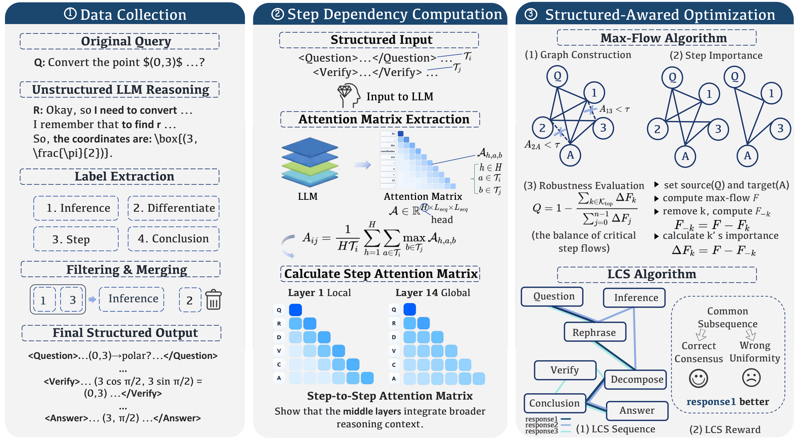
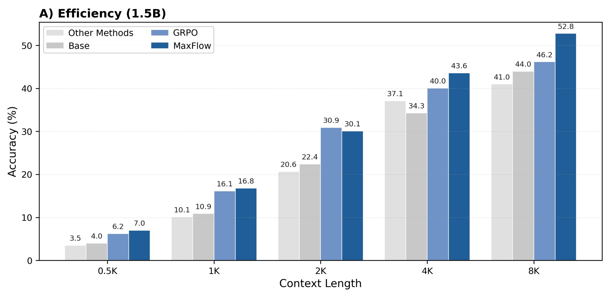
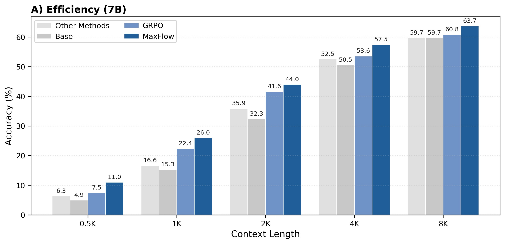
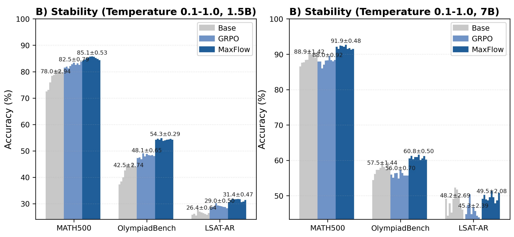
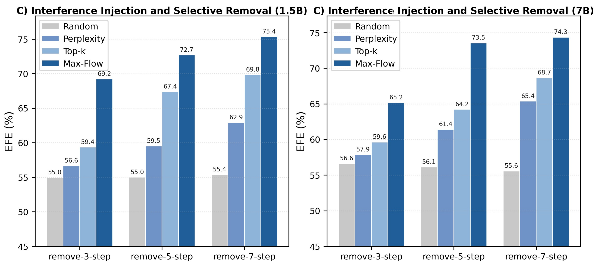

# Structured Reasoning for LLMs

<p align="center">
  <a href="https://proceedings.iclr.cc/paper_files/paper/2026/hash/ad5b3f324b24c17cdc2f3712298c76bd-Abstract-Conference.html"></a>
  <a href="https://arxiv.org/abs/2506.20241"></a>
  <a href="https://huggingface.co/datasets/FreeFrank/Structured-Reasoning"></a>
  <a href="https://cnsdqd-dyb.github.io/Enhancing-Large-Language-Models-through-Structured-Reasoning/analyzer.html#SRA"></a>
  <a href="LICENSE"></a>
</p>

**Structured Reasoning for LLMs: A Unified Framework for Efficiency and Explainability**  
Yubo Dong, Hehe Fan, Linchao Zhu, and Yi Yang · ICLR 2026

[Paper](https://proceedings.iclr.cc/paper_files/paper/2026/hash/ad5b3f324b24c17cdc2f3712298c76bd-Abstract-Conference.html) · [Project page](https://cnsdqd-dyb.github.io/Enhancing-Large-Language-Models-through-Structured-Reasoning/) · [Dataset](https://huggingface.co/datasets/FreeFrank/Structured-Reasoning) · [Interactive analyzer](https://cnsdqd-dyb.github.io/Enhancing-Large-Language-Models-through-Structured-Reasoning/analyzer.html#SRA)

This repository contains the first public code release for Structured Reasoning: structured supervised fine-tuning, cognitive-step parsing, the MaxFlow and LCS reward kernels, and evaluation analysis tools.

## Method

<p align="center">
  <a href="docs/static/images/method/pipeline.png"></a>
</p>

The framework turns a reasoning trace into explicit cognitive steps, derives a directed step graph from attention, and optimizes the graph at step level:

1. **Structure:** annotate reasoning spans with domain-agnostic cognitive-step tags.
2. **Connect:** aggregate token attention into a directed step-to-step capacity matrix.
3. **Optimize:** use **MaxFlow** for a single graph and fuzzy **LCS** across sampled trajectories.

MaxFlow measures the change in source-to-answer flow after removing each intermediate step. LCS finds reliable common paths among multiple responses while favoring concise matched steps.

## Installation

```bash
git clone https://github.com/cnsdqd-dyb/Enhancing-Large-Language-Models-through-Structured-Reasoning.git
cd Enhancing-Large-Language-Models-through-Structured-Reasoning
python -m pip install -e ".[train,analysis,test]"
```

Python 3.10 or newer is required. Training also requires a CUDA-compatible PyTorch installation appropriate for your hardware.

## Structured SFT

The training entry point reads the public Hugging Face dataset directly, serializes each assistant response as `<think> structured reasoning </think> final answer`, and masks user-prompt tokens from the language-model loss.

```bash
torchrun --nproc_per_node 8 scripts/train_sft.py \
  --model_name_or_path deepseek-ai/DeepSeek-R1-Distill-Qwen-1.5B \
  --dataset_name FreeFrank/Structured-Reasoning \
  --max_length 32768 \
  --output_dir outputs/structured-sft-1.5b \
  --bf16 True \
  --gradient_checkpointing True \
  --per_device_train_batch_size 1 \
  --gradient_accumulation_steps 8 \
  --learning_rate 2e-5 \
  --num_train_epochs 3 \
  --save_strategy epoch
```

Inspect or export the exact chat records before training:

```bash
python scripts/prepare_sft_data.py --output data/structured_reasoning.jsonl
```

The longest example reported in the dataset card can exceed 26k tokens with a Qwen tokenizer. Reduce `--max_length` only when truncation is acceptable for your experiment.

## MaxFlow reward

`maxflow_reward` accepts an `N × N` non-negative attention-capacity matrix ordered from the first reasoning step to the answer step. It returns the graph reward, total source-to-answer flow, and leave-one-out importance of every step.

```python
from structured_reasoning import maxflow_reward

result = maxflow_reward([
    [0.0, 0.8, 0.2, 0.0],
    [0.0, 0.0, 0.4, 0.7],
    [0.0, 0.0, 0.0, 0.6],
    [0.0, 0.0, 0.0, 0.0],
])
print(result.reward, result.importance)
```

Run the same example from the command line:

```bash
python scripts/score_graph.py examples/attention_matrix.json
```

The public function begins at the step-attention matrix boundary. Reproducing the paper's matrices requires the same layer/head aggregation and model instrumentation; that extraction component is still being cleaned for release and is tracked in [`ROADMAP.md`](ROADMAP.md).

## LCS reward

The LCS implementation compares structured trajectories using tag equality or word-level Jaccard similarity, aligns them in order, and assigns group-relative rewards using correctness and step length.

```python
from structured_reasoning import Step, group_lcs_rewards

traces = [
    [Step("plan", "solve the equation"), Step("check", "verify x")],
    [Step("plan", "solve the equation"), Step("answer", "x is two")],
]
rewards = group_lcs_rewards(traces, correct=[True, True])
```

## Analysis scripts

Aggregate LightEval JSON files across seeds, temperatures, and token budgets:

```bash
python scripts/analyze_evaluations.py path/to/lighteval/results \
  --output outputs/evaluation_summary.csv
```

Analyze step counts, trace length, malformed outputs, and the 23 most frequent tags from JSONL records:

```bash
python scripts/analyze_traces.py traces.jsonl > outputs/trace_report.json
```

Each JSONL record should contain `reasoning` and `correct`; alternate field names can be supplied with `--reasoning-field` and `--correct-field`.

## Paper results

<table>
  <tr>
    <td width="50%" align="center"><br><sub>Efficiency · 1.5B</sub></td>
    <td width="50%" align="center"><br><sub>Efficiency · 7B</sub></td>
  </tr>
</table>

<p align="center">
  <br>
  <sub>Stability across decoding temperatures</sub>
</p>

<p align="center">
  <br>
  <sub>Interference injection and selective step removal</sub>
</p>

See the [ICLR paper](https://proceedings.iclr.cc/paper_files/paper/2026/hash/ad5b3f324b24c17cdc2f3712298c76bd-Abstract-Conference.html) for experimental settings, baselines, and reported results.

## Repository layout

```text
src/structured_reasoning/   step parsing and MaxFlow/LCS reward kernels
scripts/train_sft.py        structured supervised fine-tuning
scripts/prepare_sft_data.py dataset validation and JSONL export
scripts/analyze_*.py        evaluation and trace analysis
docs/                       project page and interactive analyzer
tests/                      deterministic tests for released kernels
```

## Release status

Available now: paper, dataset, website, structured SFT code, MaxFlow/LCS kernels, and analysis scripts. Model checkpoints, the instrumented attention extractor, and the full distributed GRPO experiment launcher remain in preparation. See the [release roadmap](ROADMAP.md) for exact boundaries.

## Citation

```bibtex
@inproceedings{dong2026structuredreasoning,
  title     = {Structured Reasoning for LLMs: A Unified Framework for Efficiency and Explainability},
  author    = {Dong, Yubo and Fan, Hehe and Zhu, Linchao and Yang, Yi},
  booktitle = {International Conference on Learning Representations},
  year      = {2026},
  url       = {https://proceedings.iclr.cc/paper_files/paper/2026/hash/ad5b3f324b24c17cdc2f3712298c76bd-Abstract-Conference.html}
}
```

The released code is licensed under the [MIT License](LICENSE). Dataset licensing and provenance are documented separately on its [Hugging Face dataset card](https://huggingface.co/datasets/FreeFrank/Structured-Reasoning).
